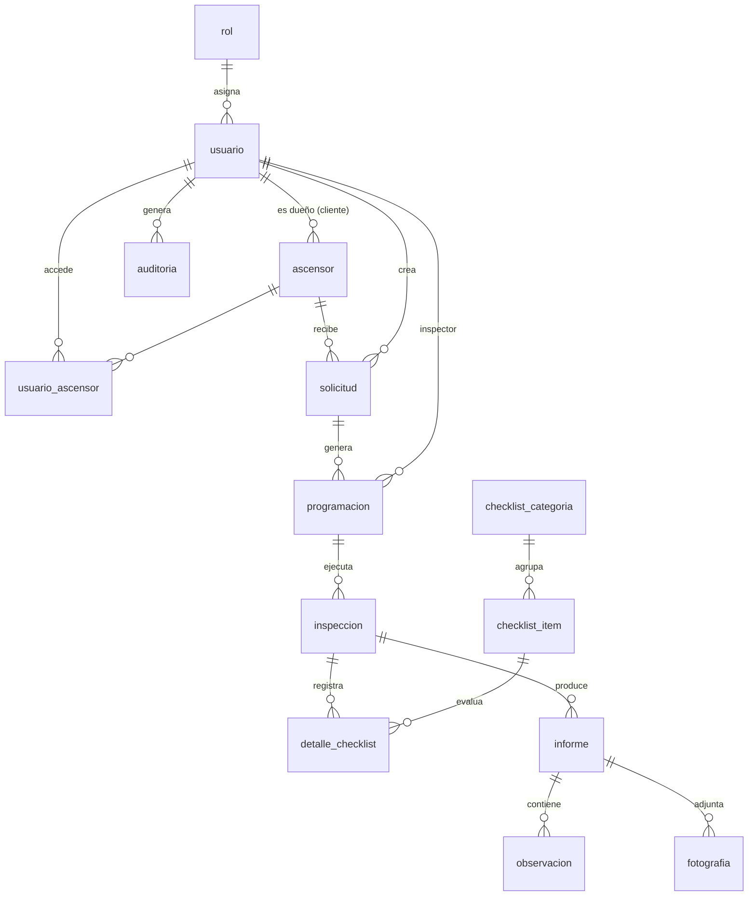

# LiftSafe DB: base de datos para inspección de ascensores


Base de datos relacional para **LiftSafe**, un sistema que gestiona el ciclo completo de inspección de ascensores según la norma **NTC 5926-1:2012**: solicitudes de clientes, programación de inspectores, ejecución con checklist, informes, evidencias fotográficas y auditoría.

## Lo que demuestra este proyecto

- **Modelado relacional** de un proceso de negocio real: 14 tablas normalizadas y 21 llaves foráneas con reglas `ON DELETE CASCADE` / `SET NULL`.
- **Control de acceso por roles**: Administrador, Director Técnico, Coordinador, Inspector, Asesor y Cliente.
- **Trazabilidad**: tabla `auditoria` que guarda la acción, el valor anterior y el nuevo en JSON, la IP y el navegador.
- **Datos de prueba realistas**: 35 usuarios, 22 ascensores, 22 solicitudes e inspecciones, 21 programaciones e informes.
- **Consultas analíticas** con `JOIN` de varias tablas, `GROUP BY`, funciones de fecha (`DATE_FORMAT`, `DAYNAME`, `TIMESTAMPDIFF`) y cálculo de ocupación de inspectores.

## Modelo de datos



| Tabla | Descripción |
|---|---|
| `rol` | Roles del sistema y sus permisos |
| `usuario` | Usuarios (administradores, inspectores, clientes, etc.) |
| `ascensor` | Ascensores registrados: marca, modelo, capacidad, ubicación y estado |
| `usuario_ascensor` | Usuarios con acceso a cada ascensor |
| `solicitud` | Solicitudes de inspección de los clientes, con tipo de servicio y prioridad |
| `programacion` | Agenda de inspecciones: fecha, horario e inspector asignado |
| `inspeccion` | Ejecución de la inspección |
| `checklist_categoria` / `checklist_item` | Checklist de la norma (20 categorías y 20 ítems) |
| `detalle_checklist` | Resultado de cada ítem en una inspección |
| `informe` / `observacion` / `fotografia` | Informe final, hallazgos y evidencias |
| `auditoria` | Registro de actividad del sistema |

## Cómo usarla

Requisitos: MySQL 8 o MariaDB 10.4+ (el volcado se generó con phpMyAdmin / XAMPP).

```bash
git clone https://github.com/mpdayan1804/liftsafe-database1.git
cd liftsafe-database1

mysql -u root -p -e "CREATE DATABASE liftsafe_db CHARACTER SET utf8mb4 COLLATE utf8mb4_unicode_ci;"
mysql -u root -p liftsafe_db < liftsafe_db_completa.sql
mysql -u root -p liftsafe_db < consultas.sql
```

También puedes importar `liftsafe_db_completa.sql` desde phpMyAdmin (**Importar**) o desde MySQL Workbench (**File → Run SQL Script**).

<details>
<summary>Probar con Docker, sin instalar MySQL</summary>

```bash
docker run -d --name liftsafe -e MARIADB_ROOT_PASSWORD=root -e MARIADB_DATABASE=liftsafe_db mariadb:10.4
docker exec -i liftsafe mysql -uroot -proot liftsafe_db < liftsafe_db_completa.sql
docker exec -it liftsafe mysql -uroot -proot liftsafe_db
```
</details>

## Consultas incluidas (`consultas.sql`)

Reporte de programación semanal de los inspectores (jornada de 8 horas, de lunes a viernes):

1. **Programación semanal:** fecha, horario, inspector, ascensor, cliente, tipo de servicio y prioridad.
2. **Horas por inspector:** inspecciones, horas programadas, horas disponibles y porcentaje de ocupación sobre 40 horas.
3. **Distribución de inspecciones por día.**
4. **Consulta simple** de datos básicos y **verificación** de programaciones en la semana.

## Autora

**Dayan Lorena Mape Forero**, estudiante de Tecnología en Desarrollo y Análisis de Datos, Bogotá, Colombia. [GitHub](https://github.com/mpdayan1804)
